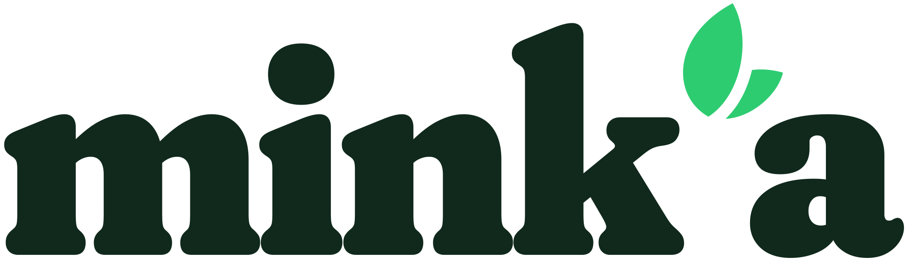
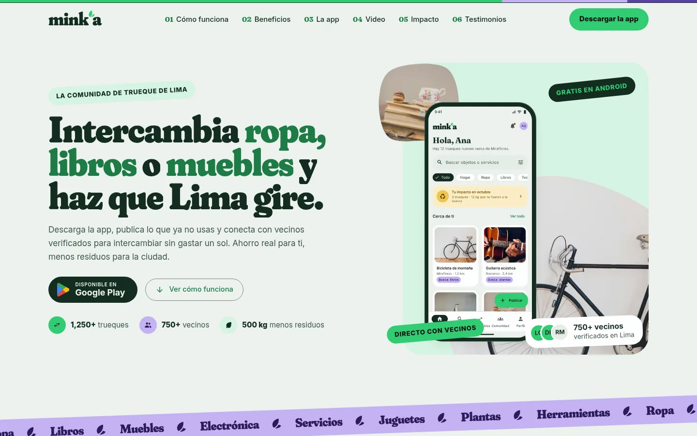
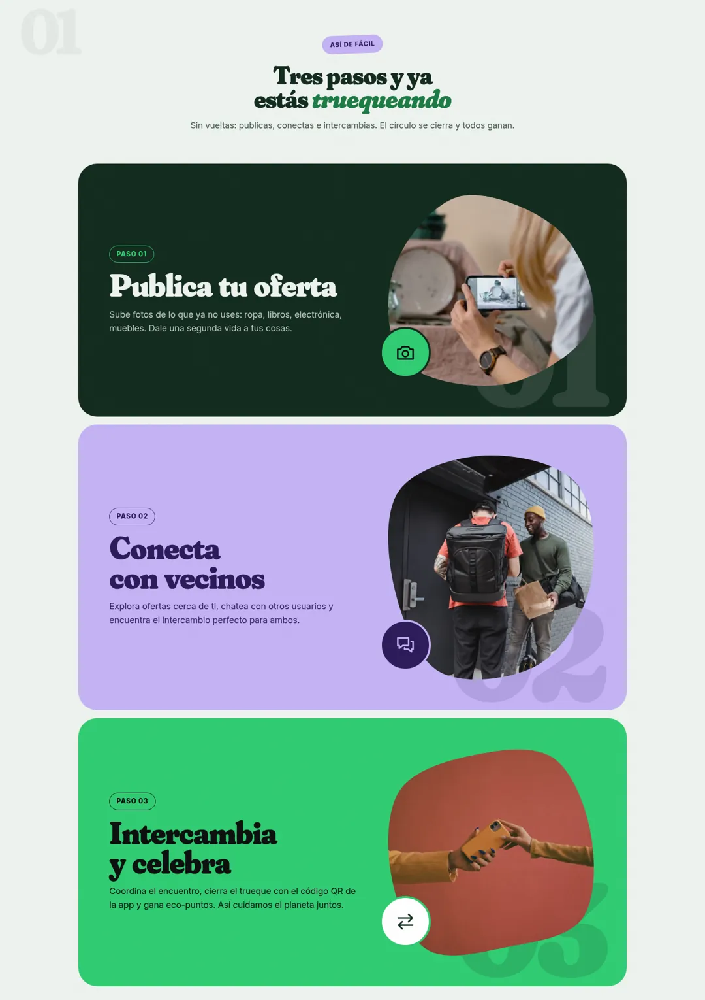
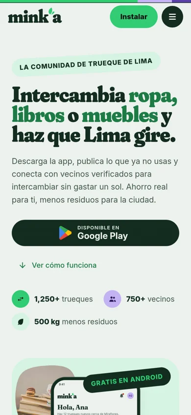
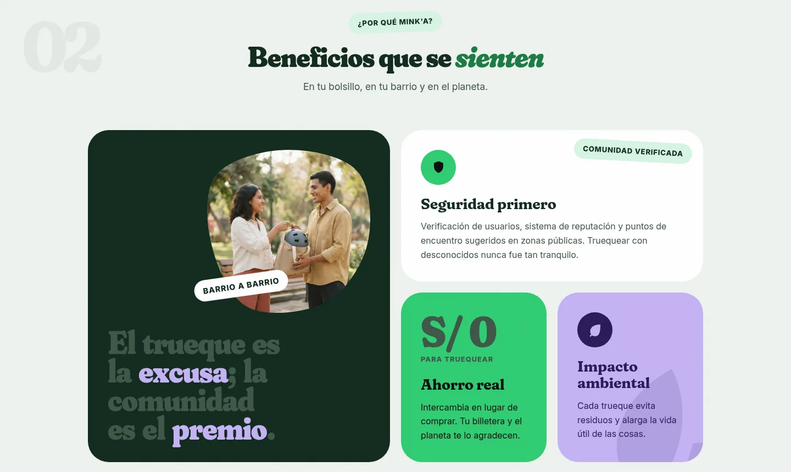
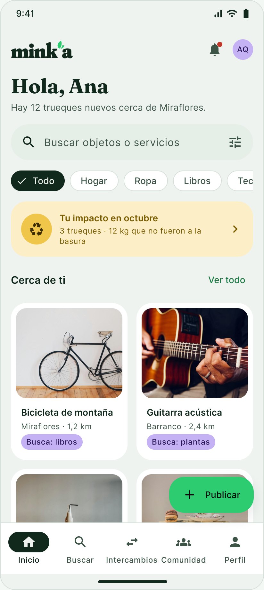
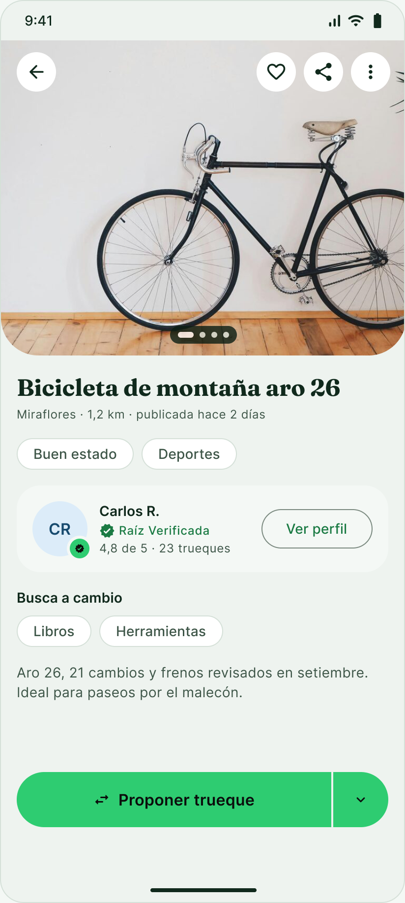
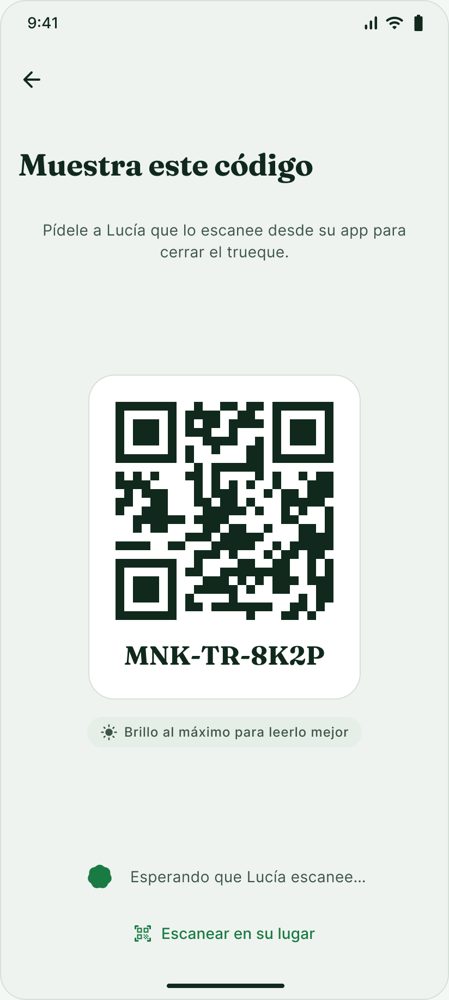
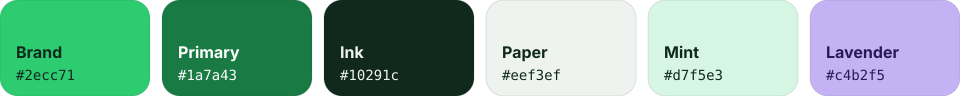

<!-- markdownlint-disable MD033 MD041 -->
<p align="center">
  <a href="https://minka.jahattrinidad.com/">
    <picture>
      <source media="(prefers-color-scheme: dark)" srcset="docs/readme/logotype-dark.svg">
      
    </picture>
  </a>
</p>

<h3 align="center">Intercambia ropa, libros o muebles y haz que Lima gire.</h3>

<p align="center">
  Landing page de Mink’a, la app Android de trueque comunitario<br>
  para darle una segunda vida a lo que ya no usas.
</p>

<p align="center">
  <a href="https://minka.jahattrinidad.com/"></a>
  <a href="https://github.com/trinity-bytes/minka/releases"></a>
  <a href="https://github.com/trinity-bytes/minka/actions/workflows/pages.yml"></a>
</p>

<p align="center">
  <a href="https://minka.jahattrinidad.com/">
    
  </a>
</p>

---

## ¿Qué es Mink’a?

**Mink’a** toma su nombre de la *minka* andina, el trabajo colectivo en beneficio de la comunidad. Es una plataforma de **trueque y economía circular** para Lima: publicas lo que ya no usas, conectas con vecinos verificados e intercambias sin gastar un sol.

Este repositorio contiene la **landing page**: comunica la propuesta de valor y lleva a las personas a instalar la app Android.

| 🔁 Trueque directo | 🛡️ Vecinos verificados | 🌱 Menos residuos |
| :---: | :---: | :---: |
| Ropa, libros, muebles, electrónica o servicios, sin dinero de por medio. | Reputación y puntos de encuentro sugeridos en zonas públicas. | Cada intercambio alarga la vida útil de un objeto. |

## Un recorrido por la landing

<table>
  <tr>
    <td width="68%" valign="top">
      
    </td>
    <td width="32%" valign="top">
      
    </td>
  </tr>
  <tr>
    <td align="center"><sub><b>Cómo funciona</b>: tres pasos con fotos recortadas en formas orgánicas</sub></td>
    <td align="center"><sub><b>Mobile first</b>: menú accesible y CTA siempre visible</sub></td>
  </tr>
</table>

<p align="center">
  
  <br><sub><b>Beneficios</b>: bento grid con la paleta completa de la marca</sub>
</p>

### La app que se muestra

<p align="center">
  
  &nbsp;&nbsp;
  
  &nbsp;&nbsp;
  
</p>
<p align="center"><sub>Inicio · Detalle de la oferta · Cierre del trueque con QR</sub></p>

## Identidad visual

<p align="center">
  
</p>

- **Logotipo**: *mink’a* en Fraunces Black con un apóstrofo de dos hojas dibujado a mano. Los trazos viven como SVG en [`src/assets/brand/paths.ts`](src/assets/brand/paths.ts).
- **Tipografía**: **Fraunces** (display, soft y en su tamaño óptico más grande) para titulares e **Inter** para la interfaz. Ambas se sirven como WOFF2 variables.
- **Color**: verde bosque sobre papel con un toque lavanda. Todas las combinaciones de texto cumplen contraste AA y nunca se pone verde sobre lavanda.
- **Fuente única**: los tokens viven en [`src/styles/tokens.css`](src/styles/tokens.css) y las reglas completas en [docs/visual-language.md](docs/visual-language.md).
- **Diseño**: el Figma es la referencia. Las tarjetas sociales salen del tablero *Publicación* (página Cover).

## Características

- **Responsiva y mobile first**: se ve bien en móvil, tablet y escritorio.
- **Accesible**: HTML semántico, navegación por teclado, menú con focus trap y soporte de `forced-colors`.
- **Microinteracciones con criterio**: parallax por capas en el hero, badge magnético de Google Play, video que se expande y olas que se inflan con el scroll. Se desactivan con `prefers-reduced-motion` y en pantallas táctiles.
- **Rápida**: imágenes AVIF/WebP con `srcset` y carga diferida, sin frameworks de UI en el cliente.
- **Lista para compartir**: sitemap, página 404 propia y tarjeta Open Graph/Twitter de 1200×630.
- **Deploy automático**: cada push a `main` publica el sitio en GitHub Pages con dominio propio.

## Stack

| | |
| --- | --- |
| **Framework** | [Astro 7](https://astro.build/) con salida estática, `astro:assets` y `@astrojs/sitemap` |
| **Lenguajes** | TypeScript, JavaScript ES2022+, CSS moderno con custom properties |
| **Tests** | Runner nativo de Node (`node --test`) |
| **Hosting** | GitHub Actions + GitHub Pages |
| **Flujo** | GitFlow (`develop`, `feat/*`, `release/*`, `main`) y Conventional Commits |

## Estructura

```text
astro.config.mjs              # Salida estática, build.format "file", sitemap
src/
├── pages/                    # index.astro (landing) y 404.astro
├── components/
│   ├── layout/               # BaseLayout, SiteHeader, SiteFooter
│   ├── brand/                # Logotype y Logomark (SVG inline)
│   ├── ui/                   # Button, StoreBadge, Avatar, Sticker, BlobMedia, IconChip, …
│   └── landing/              # Secciones de la landing y PhoneFrame
├── assets/
│   ├── brand/                # Trazos del logo e ícono de Google Play
│   └── images/               # Fotos y pantallas de la app
├── styles/                   # tokens.css, fonts.css, global.css
├── scripts/                  # Menú accesible, reveal y helpers puros con tests
└── lib/                      # Helpers de URL y link de Google Play
public/                       # CNAME, favicon, og-image.png y fuentes WOFF2
docs/                         # Lenguaje visual, marca e imágenes de este README
tests/                        # Tests unitarios de los helpers
```

## Desarrollo

Requiere **Node 24** (ver [`.nvmrc`](.nvmrc)).

```bash
git clone https://github.com/trinity-bytes/minka.git
cd minka
npm install
npm run dev        # http://localhost:4321
```

| Script | Qué hace |
| --- | --- |
| `npm run dev` | Servidor de desarrollo con recarga en caliente |
| `npm run build` | Genera el sitio estático en `dist/` (incluye `404.html` y sitemap) |
| `npm run preview` | Sirve `dist/` para validar el build |
| `npm run check` | Revisa tipos y plantillas con `astro check` |
| `npm test` | Corre los tests unitarios |

**Para contribuir**: crea una rama desde `develop` (`git checkout -b feat/mi-cambio develop`), haz commits con [Conventional Commits](https://www.conventionalcommits.org/) y abre un PR hacia `develop`. Al fusionar en `main`, [`pages.yml`](.github/workflows/pages.yml) construye y publica el sitio.

## Equipo

Proyecto nacido en la UPC por el equipo **Reflow Tech**:

Leonardo Chávez · Lucero Pipa · Ronel Rojas · Andy Salcedo · Miguel Sanca · Jahat Trinidad

Repositorio original del equipo: [Reflow-Tech-UPC/Minka-Landingpage](https://github.com/Reflow-Tech-UPC/Minka-Landingpage).

---

<p align="center">
  <a href="https://minka.jahattrinidad.com/"><b>minka.jahattrinidad.com</b></a>
  <br>
  <sub>Hecho con 💚 para que las cosas sigan circulando.</sub>
</p>
